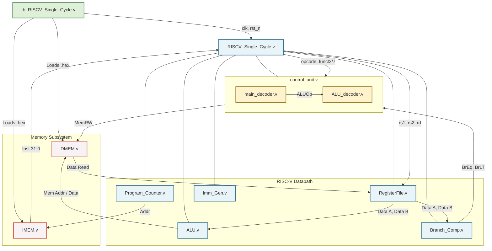

# RISC-V Single-Cycle

## Project Overview
This repository contains the RTL design and verification environment for a custom **32-bit RISC-V Single-Cycle Processor (RV32I)**. This core implements a subset of the RV32I base integer instruction set and is designed to execute each instruction in exactly one clock cycle. 

This project was developed to demonstrate practical experience in computer architecture, instruction decoding, datapath routing, and hardware verification using self-checking assembly programs with Cadence EDA tools.

## Key Features
- **RV32I Base Integer Instruction Set**: Supports R-Type, I-Type, Load/Store, Branch, and Jump instructions.
- **Single-Cycle Execution**: The datapath uses combinational logic between sequential state elements to perform instruction fetch, decode, execute, memory access, and write-back sequence to complete in one clock cycle.
- **Modular Architecture**: The design is partitioned into functional units (Control Unit, ALU, Register File, Branch Comparator, Immediate Generator) for clarity and maintainability.
- **Self-Checking Verification**: Includes a robust testbench and an assembly-based software test (`test.S`) that automatically verifies ALU operations, branches, memory accesses, and flags success/failure directly to the simulator console.

## Hardware Architecture

The system is partitioned into standard RISC-V single-cycle datapath blocks. Below is the block diagram of the processor core and its verification environment.



### Module Descriptions:
1. **`RISCV_Single_Cycle.v`**: The top-level wrapper module. It instantiates all the components below, handling the complex wire routing between the datapath, control path, and memory interfaces.
2. **`Program_Counter.v`**: A synchronous register that holds the current instruction address (`PC`). It updates to `PC+4` or a branch/jump target address on every clock edge.
3. **`control_unit.v`**: The top-level control block. It evaluates branch conditions (`Branch_Taken`) and instantiates the two internal decoders below to generate all control signals (`PCSel`, `RegWEn`, `MemRW`, `WBSel`, etc.).
   - **`main_decoder.v`**: Analyzes the instruction `opcode` to determine the instruction type and asserts high-level datapath routing signals (Multiplexer selects, memory writes) and a 2-bit `ALUOp`.
   - **`ALU_decoder.v`**: Takes the `ALUOp` from the main decoder along with instruction fields `funct3` and `funct7` to generate the precise 4-bit `ALUSel` signal for the ALU.
4. **`RegisterFile.v`**: The architectural state of the CPU. A 32-word by 32-bit memory array with two asynchronous read ports and one synchronous write port. Register `x0` is hardwired to zero.
5. **`ALU.v`**: The core Arithmetic Logic Unit. It executes the computation determined by `ALUSel`, including addition, subtraction, logical bitwise operations, shifts, and setting conditions (signed and unsigned).
6. **`Imm_Gen.v`**: The Immediate Generator. It receives the full 32-bit instruction and the `ImmSel` control signal to correctly extract and sign-extend the immediate fields for I, S, B, U, and J type instructions.
7. **`Branch_Comp.v`**: A dedicated comparison unit that evaluates the data from two source registers. It outputs `BrEq` (Equal) and `BrLT` (Less Than), factoring in the `BrUn` (Unsigned) control signal for accurate branch resolution.
8. **`IMEM.v`**: Instruction Memory simulation model. It acts as a read-only memory (ROM) holding the compiled software instructions.
9. **`DMEM.v`**: Data Memory simulation model. It supports byte, half-word, and word reads/writes based on the standard RISC-V memory access instructions.

## Instruction Set Architecture (ISA) Support

The core implements the following standard RV32I instructions. The Control Unit guarantees appropriate datapath routing for each format:

| Type       | Instructions Supported | Description |
|------------|------------------------|-------------|
| **R-Type** | `add`, `sub`, `and`, `or`, `xor`, `sll`, `srl`, `sra`, `slt`, `sltu` | Register-to-register arithmetic and logic operations. |
| **I-Type** | `addi`, `slti`, `sltiu`, `xori`, `ori`, `andi`, `slli`, `srli`, `srai`, `jalr` | Register-immediate arithmetic and logic operations. |
| **Load**   | `lw` | Load Word (32-bit) from Data Memory. *(Extensible to lb, lh, lbu, lhu)* |
| **Store**  | `sw` | Store Word (32-bit) to Data Memory. *(Extensible to sb, sh)* |
| **B-Type** | `beq`, `bne`, `blt`, `bge`, `bltu`, `bgeu` | Conditional branches evaluating equality and magnitude. |
| **J-Type** | `jal` | Jump and Link (unconditional jump with return address saving). |
| **U-Type** | `lui`, `auipc` | Upper immediate operations and indirect jumps. |

## Verification Environment
The design is verified using a pure Verilog testbench (`tb_RISCV_Single_Cycle.v`). 
* **Self-Checking Assembly Program**: The core executes test.S, a custom assembly program designed to test the supported instruction types, jump and branch instructions, and signed/unsigned comparisons.
* **Automated Checking**: The testbench continuously monitors the value of register `x7`. If a test passes, the software writes `1` to `x7`; if it fails, it writes `-1` (`0xFFFFFFFF`). The testbench will automatically halt and report the status based on this register.

## Simulation & Synthesis (Cadence EDA Flow)

This project is built and verified using industry-standard Cadence EDA tools. A configured `Makefile` is provided to automate RTL simulation (Xcelium), logic synthesis (Genus), and logic equivalence checking (Conformal).

*(Note: Ensure that variables like `TOP_TB` and `TOP_SYN` in the Makefile are configured to match this project's top modules: `tb_RISCV_Single_Cycle` and `RISCV_Single_Cycle`.)*

### RTL Simulation (Cadence Xcelium)

The simulation flow consists of the following steps:

**Compile RTL files:**
```bash
make compile
```

**Elaborate the testbench:**
```bash
make build
```

**Run RTL simulation:**
```bash
make run
```

**Run simulation and launch the waveform viewer (Cadence SimVision):**
```bash
make wave
```

### Logic Synthesis (Cadence Genus)

```bash
make syn
```

### Logic Equivalence Checking (Cadence Conformal)

```bash
make lec
```

*Expected Output (from `make run`):*
```text
========================================
 [PASSED] ALL TESTS PASSED!
 Total Instructions Executed = 15
 Error Count = 0
========================================
```
